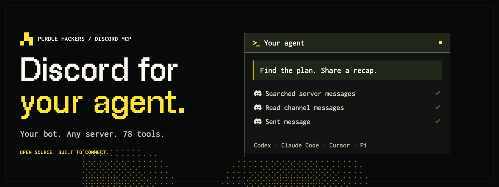

<p align="center">
  <a href="https://github.com/purduehackers/discord-mcp/actions/workflows/check.yml"></a>
  <a href="LICENSE"></a>
  <a href="#what-can-it-do"></a>
</p>

**Read, search, and manage Discord from your AI agent.**

Discord MCP connects Codex, Claude Code, Cursor, Pi, and other MCP clients to Discord.
Bring your own bot token and use it with any server your bot can access.
Use the public endpoint or [run it yourself](#self-host).

[Install](#install) · [Client setup](#client-setup) · [Tools](#what-can-it-do) · [Contribute](#contributing)

## Install

**Paste this into your agent:**

```text
Install Discord MCP for this agent using the instructions at
https://github.com/purduehackers/discord-mcp.

Use the hosted Streamable HTTP server at
https://discord.purduehackers.com/mcp with X-Discord-Token
set from my DISCORD_BOT_TOKEN environment variable.

Configure this client's user-level MCP settings and preserve existing servers.
If the token is missing, help me create a Discord bot and set it locally;
do not ask me to paste the token into chat or commit it to a repository.

Reconnect, call diagnose_connection, and show which bot and servers I can use.
Do not send messages or change Discord during setup.
```

### Get a bot token

1. [Create a Discord application](https://discord.com/developers/applications). Open **Bot** and copy its token.
2. Install the bot in your server with the permissions you need. Enable **Message Content Intent** for message search and reading content.
3. Set the token where you launch your agent:

```sh
export DISCORD_BOT_TOKEN='YOUR_DISCORD_BOT_TOKEN'
```

Need a walkthrough? Follow [Discord's bot setup guide](https://docs.discord.com/developers/quick-start/getting-started).

## Client setup

Already have a token? Pick your client below. Use **Streamable HTTP**, the endpoint below, and the **X-Discord-Token** header.
Supply the raw token without a `Bot ` prefix.

```text
https://discord.purduehackers.com/mcp
```

<details>
<summary><strong>Codex — CLI, desktop, and IDE</strong></summary>

Register the endpoint:

```sh
codex mcp add discord --url https://discord.purduehackers.com/mcp
```

In `~/.codex/config.toml`, add `env_http_headers` to the generated entry:

```toml
[mcp_servers.discord]
url = "https://discord.purduehackers.com/mcp"
env_http_headers = { "X-Discord-Token" = "DISCORD_BOT_TOKEN" }
```

For a desktop app without that environment variable, use `http_headers = { "X-Discord-Token" = "YOUR_DISCORD_BOT_TOKEN" }` instead.
Keep that value in your private user configuration, or use a credential helper as described in the [Codex MCP documentation](https://learn.chatgpt.com/docs/extend/mcp).

Run `codex mcp get discord` to inspect the configuration, then restart the MCP connection or start a new Codex session.

</details>

<details>
<summary><strong>Claude Code</strong></summary>

```sh
claude mcp add --scope user --transport http discord \
  https://discord.purduehackers.com/mcp \
  --header 'X-Discord-Token: ${DISCORD_BOT_TOKEN}'
claude mcp list
```

Keep the single quotes: Claude resolves the environment variable when connecting.
Open `/mcp` in Claude Code to inspect the connection. [Claude Code MCP documentation](https://code.claude.com/docs/en/mcp).

</details>

<details>
<summary><strong>Pi</strong></summary>

Pi 1.x includes native MCP support:

```sh
pi mcp add discord --url https://discord.purduehackers.com/mcp \
  --header 'X-Discord-Token=${DISCORD_BOT_TOKEN}'
pi mcp list
```

This writes to `~/.pi/agent/mcp.json`. Run `/reload` in an existing session, then `/mcp` to inspect the connection.
[Pi MCP documentation](https://pi.dev/docs/latest/mcp).

</details>

<details>
<summary><strong>Cursor</strong></summary>

Add this server to `~/.cursor/mcp.json`:

```json
{
  "mcpServers": {
    "discord": {
      "url": "https://discord.purduehackers.com/mcp",
      "headers": {
        "X-Discord-Token": "${env:DISCORD_BOT_TOKEN}"
      }
    }
  }
}
```

Enable the server in Cursor's MCP settings. [Cursor MCP documentation](https://cursor.com/docs/mcp).

</details>

<details>
<summary><strong>VS Code / GitHub Copilot</strong></summary>

Install into the VS Code user-profile configuration from your terminal:

```sh
code --add-mcp '{"name":"discord","type":"http","url":"https://discord.purduehackers.com/mcp","headers":{"X-Discord-Token":"${env:DISCORD_BOT_TOKEN}"}}'
```

Use **MCP: List Servers** to start the server and inspect its tools.
For a configuration shared with Copilot CLI, add this to `~/.copilot/mcp-config.json` instead:

```json
{
  "mcpServers": {
    "discord": {
      "type": "http",
      "url": "https://discord.purduehackers.com/mcp",
      "headers": {
        "X-Discord-Token": "${DISCORD_BOT_TOKEN}"
      }
    }
  }
}
```

[VS Code MCP reference](https://code.visualstudio.com/docs/agents/reference/mcp-configuration).

</details>

<details>
<summary><strong>Gemini CLI</strong></summary>

```sh
gemini mcp add --scope user --transport http discord \
  https://discord.purduehackers.com/mcp \
  --header 'X-Discord-Token: ${DISCORD_BOT_TOKEN}'
gemini mcp list
```

Open `/mcp` in Gemini CLI to inspect the connection. [Gemini CLI MCP documentation](https://geminicli.com/docs/tools/mcp-server/).

</details>

<details>
<summary><strong>OpenCode</strong></summary>

Add this server to `~/.config/opencode/opencode.json`:

```json
{
  "$schema": "https://opencode.ai/config.json",
  "mcp": {
    "discord": {
      "type": "remote",
      "url": "https://discord.purduehackers.com/mcp",
      "oauth": false,
      "headers": {
        "X-Discord-Token": "{env:DISCORD_BOT_TOKEN}"
      }
    }
  }
}
```

Run `opencode mcp list` to inspect the connection. [OpenCode MCP documentation](https://opencode.ai/docs/mcp-servers/).

</details>

Other clients work too if they support Streamable HTTP with custom headers.
Desktop apps must receive `DISCORD_BOT_TOKEN` in their own environment; exporting it in a terminal does not update an app that is already running.

## Try it

Once connected, ask your agent:

> Check my Discord connection and show the servers I can access.

> Find the discussion about our launch date and link the original messages.

> Summarize the latest updates in #projects.

> Post this release note to #announcements.

The agent discovers server, channel, and member IDs through the tools. You choose the server; there is no shared or default server.

## What can it do?

|                     | Capabilities                                                                                                                   |
| ------------------- | ------------------------------------------------------------------------------------------------------------------------------ |
| **Find context**    | Indexed message search, channel history, individual messages, and audit logs.                                                  |
| **Communicate**     | Messages, replies, DMs, native forwards, files, embeds, reactions, and pins. Long messages preserve code fences across chunks. |
| **Manage a server** | Channels, threads, members, roles, invites, events, emoji, stickers, and webhooks.                                             |
| **Moderate**        | Timeouts, kicks, bans, message cleanup, and auto-moderation rules.                                                             |
| **Troubleshoot**    | Connection diagnostics, channel permissions, role hierarchy guidance, and actionable Discord errors.                           |

All **78 tools** have typed inputs and outputs. Codex gets readable activity labels; Claude gets tool search hints.
Browse the [tool implementations](src/tools) for the full set.

<details>
<summary><strong>Permissions, limits, and credentials</strong></summary>

- Discord enforces your bot's permissions. Connecting does not grant access to anyone else's servers.
- Search uses [Discord's index](https://docs.discord.com/developers/resources/message#search-guild-messages), requires Read Message History and Message Content Intent, and returns one page per call. Totals can change; a short page does not prove completion. Indexing errors include `retry_after` in seconds.
- Mentions are disabled unless explicitly selected. Long sends stop on failure and report confirmed message IDs. Check uncertain delivery before resuming with the original content and `start_chunk_index`.
- The hosted service receives your token over HTTPS and uses it for Discord requests. The application does not persist credentials.
- For a Discord OAuth access token, add `X-Discord-Auth-Prefix: Bearer`. Available tools depend on its scopes. This service does not provide an MCP OAuth login flow.

</details>

<details>
<summary><strong>Connection not working?</strong></summary>

Run `diagnose_connection` first. Include `guild_id` and `channel_id` to inspect a specific scope.

| Problem                       | Fix                                                                                                                           |
| ----------------------------- | ----------------------------------------------------------------------------------------------------------------------------- |
| Missing token                 | Send `X-Discord-Token` on every request. Check the client's environment and header configuration.                             |
| Discord returns 401           | Use a valid raw bot token and the correct Bot or Bearer auth prefix.                                                          |
| Missing access or permissions | Check bot membership, channel overwrites, and role hierarchy.                                                                 |
| Empty message content         | Enable the application's [Message Content Intent](https://docs.discord.com/developers/events/gateway#message-content-intent). |
| Tools missing after an update | Restart the MCP connection so the client refreshes its tool list.                                                             |

</details>

## Self-host

Requires [Bun](https://bun.sh). Built with [xmcp](https://xmcp.dev) and [@discordjs/rest](https://discord.js.org/docs/packages/rest/stable).

```sh
git clone https://github.com/purduehackers/discord-mcp.git
cd discord-mcp
bun install
bun run build
bun run start-http
```

HTTP accepts the same per-request headers. For stdio, set `DISCORD_BOT_TOKEN` and run `bun run start-stdio`.
Use `bun run dev` for development. Vercel deploys xmcp's native output.

## Contributing

[Issues](https://github.com/purduehackers/discord-mcp/issues) and pull requests are welcome.
Each file in `src/tools/` defines one tool; shared schemas live in `src/lib/schemas/`.
The [Remotion demo](demo) has its own dependencies. Install them before running the full checks:

```sh
bun install --cwd demo
bun run --cwd demo lint
bun run typecheck
bun run lint
bun run format --check
bun run build
```

[MIT licensed](LICENSE). Made by [Purdue Hackers](https://purduehackers.com).
